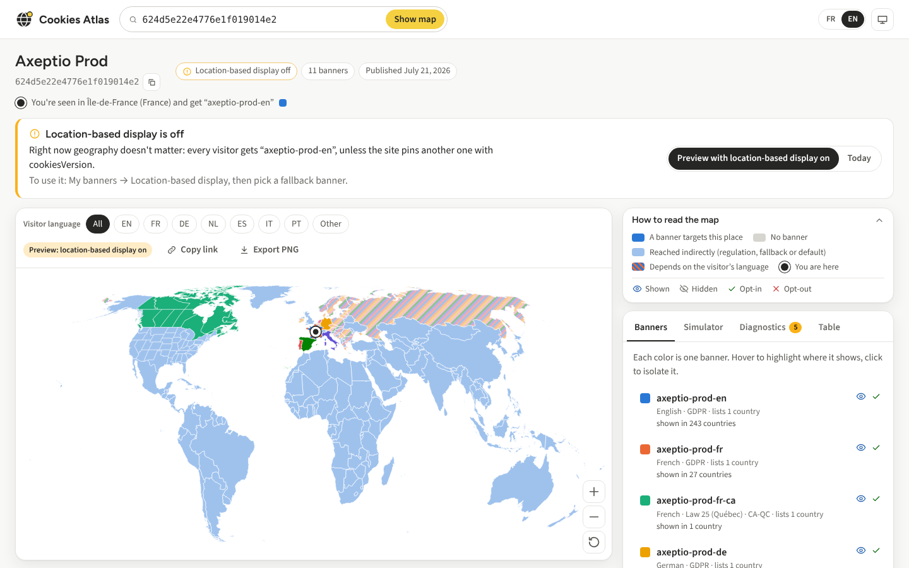

# Cookies Atlas

**See which Axeptio cookie banner each country and region gets, why, and what looks misconfigured.**

Paste an Axeptio project ID: Cookies Atlas reads the project's public, published file and replays
the Axeptio SDK's own selection rules for every country, region and visitor language. The result
is a world map, a visitor simulator that explains each step, and diagnostics written for humans.

**Live:** https://pggpgg.github.io/cookies-atlas/ · Français plus bas.



## What it does

- **Map.** Each banner gets its own color, and gray only ever means "no banner". Places where the winner depends on the visitor's language are
  striped with each candidate's color; places no banner targets (reached through the regulation
  match, the fallback or the default) are drawn lighter. Canada and the US are drawn by province and
  state, and any other country gets split when a banner targets one of its regions. The key ("How to
  read the map") sits above the side panel, so it stays visible on every tab.
- **Visitor language.** Show every outcome, or pick one language to see the exact winner.
- **Display and consent mode.** Each banner shows whether it opens by itself or stays hidden
  (`displayMode`), and whether it is opt-in or opt-out (`consentMode`): in the legend (with a tooltip
  that explains what each means for visitors), the simulator, the map's hover tooltip and the table.
- **Simulator.** Pick a place, a browser language, a page language (`html lang`), the tie-break logic
  (browser vs `useDocumentLang`), and optionally `cookiesVersion` or a page path. You get the banner
  and the SDK's steps in order, in plain words.
- **Diagnostics.** Banners that can never show, region banners that capture a whole country,
  consent-first regions getting an opt-out banner, listings that never win, malformed region or
  country codes, region codes no visitor is ever located in (a French department instead of its
  region, `US-PR` instead of the country `PR`), places where the visitor's language changes whether
  the banner opens or whether it's opt-in, missing fallback, banner-visibility settings, running A/B
  tests. Each one explains the mechanism and the fix.
- **Location-based display off?** You see what visitors get today, plus a preview of the map as if it
  were on.
- **Table** of every place (the accessible twin of the map) with a **CSV export** (one line per place
  and banner, with its modes; semicolon-separated where Excel expects it), **PNG export**, **shareable links**,
  **"you are here"** from the same CDN headers Axeptio uses, FR/EN, light and dark themes.

## How the SDK picks a banner (and so does the map)

Mirrors `getCookiesConfig()` in `https://static.axept.io/sdk.js` (see [docs/SPEC.md](docs/SPEC.md),
section 3):

1. Banner visibility gate (allowed countries), if enabled.
2. With location-based display on, in order: banners targeting the visitor's **region** (`CA-QC`),
   then banners listing **only the visitor's country**, then banners listing it **among others**, then
   banners using the **regulation** of the visitor's region (from the SDK's own table), then the
   **fallback**. At each step, banners matching the visitor's regulation are preferred, and ties go to
   the visitor's **language**, then to **list order**.
3. Otherwise: the banner pinned by `cookiesVersion`, then a banner whose page rules match, then the
   first banner in the list.

The visitor's location comes from the `X-Viewer-Country` and `X-Viewer-Country-Region` headers that
Axeptio's CDN adds to the project file. The region is always a first-level one (Île-de-France, not
Paris; England, not Kent), and US territories come through as countries, so the map paints finer
areas with their region's banner and never evaluates codes no visitor can have.

## Using it

- **Project ID**: in the Axeptio admin (bottom left of a project), or `axeptioSettings.clientId` on
  the site.
- **Bookmarklet**: drag the button from the home page to your bookmarks bar. On any site using
  Axeptio, click it to open that site's map, with the page's language settings and path prefilled
  in the simulator (never the query string).
- **Links** keep the whole state:

  | Parameter | Meaning |
  |---|---|
  | `project` | Project ID (24 hex characters) |
  | `lang` | Map language (`fr`, `en`, `*` for other); all languages when absent |
  | `region` | Simulated visitor, e.g. `CA-ON` or `FR` |
  | `blang`, `hlang`, `logic` | Browser language, page language, `logic=html` for `useDocumentLang` |
  | `cv`, `page` | `cookiesVersion` and page path for the simulator |
  | `mode` | `preview` or `actual`, for projects with location-based display off |
  | `tab` | `banners`, `simulator`, `diagnostics` or `table` |
  | `focus` | Isolated banner (config identifier) |
  | `ui` | Interface language, `fr` or `en` |
  | `internal=1` | Show links to the Axeptio admin (useful for the Axeptio team only) |

## Development

```bash
npm install
npm run dev        # http://localhost:5173
npm test           # engine, diagnostics, region table and drift-check tests
npm run test:live  # replay the live sdk.js against the engine (needs access to static.axept.io)
npm run build      # type-check + production build in dist/
npm run build:geo  # regenerate public/data and the engine's place lists from Natural Earth (~65 MB once)
```

Stack: Vite, TypeScript, Preact, d3-geo, Vitest. Map data: Natural Earth 1:10m (public domain),
simplified to TopoJSON by `scripts/build-geo.mjs` and committed under `public/data/`. Fonts
(Figtree, Source Sans 3) are self-hosted; the app makes no request to anything but its own files and
Axeptio's CDN.

```
src/engine/       the SDK port (select.ts), its region table, map-wide evaluation, diagnostics
src/i18n/         French and English copy, including every diagnostic
src/components/   map, legend, simulator, diagnostics, table, chrome
tests/            Vitest suites + trimmed real project fixtures
scripts/          map data pipeline, SDK drift check
sdk-snapshot/     what the drift check compares against
```

## Staying faithful to the SDK

- `src/engine/select.ts` is a line-by-line port of the SDK's selection code; each helper names the
  SDK function it mirrors. The tests are the contract: change the engine only when the SDK changes.
- `src/engine/regions.ts` is the SDK's region table; a test fails if it differs from
  `sdk-snapshot/snapshot.json`.
- **Live replay.** `npm run test:live` cuts the selection code out of the live `sdk.js`, runs it in
  an isolated `vm` context and compares it with the engine on ~100,000 visitor scenarios (every
  country, Canadian provinces and US states, languages, `useDocumentLang`, `cookiesVersion`, page
  rules, the three real projects and synthetic edge cases). At the time of writing: 0 differences.
- **SDK drift check** (`.github/workflows/sdk-drift.yml`) runs every Monday: it compares the region
  table, the regulation enum and fingerprints of the selection code with the snapshot, runs the live
  replay, and opens an issue labelled `sdk-drift` if anything moved. To update after reviewing the
  change: port it to `src/engine/`, then run `npm run sdk:snapshot` and commit.

## Deploying

Pushing to `main` runs `.github/workflows/deploy.yml` (tests, build, GitHub Pages). One-time setup:
**Settings → Pages → Build and deployment → Source: GitHub Actions**. The build uses relative paths,
so it also works from a fork or any static host.

## Français

Cookies Atlas montre, sur une carte du monde, quel bandeau Axeptio s'affiche dans chaque pays et
région, et pourquoi. Collez un ID de projet : l'outil lit le fichier public du projet publié et
rejoue les règles de sélection du SDK (région, pays unique, multi-pays, réglementation, fallback,
puis tie-break de langue). Le simulateur explique chaque étape pour un visiteur donné, le
diagnostic signale les bandeaux qui ne s'affichent jamais, les bandeaux régionaux qui captent tout
un pays, les régions où le consentement est requis qui reçoivent un bandeau opt-out, les endroits où
la langue du visiteur change le mode d'affichage ou de consentement, et plus. Le tableau s'exporte
en CSV. Le favori (bookmarklet) ouvre la carte de n'importe quel site qui utilise Axeptio. Interface en
français et en anglais.

## Credits

Map data © [Natural Earth](https://www.naturalearthdata.com/) (public domain). Fonts: Figtree and
Source Sans 3 (SIL Open Font License). Not affiliated with any site whose project you open.
